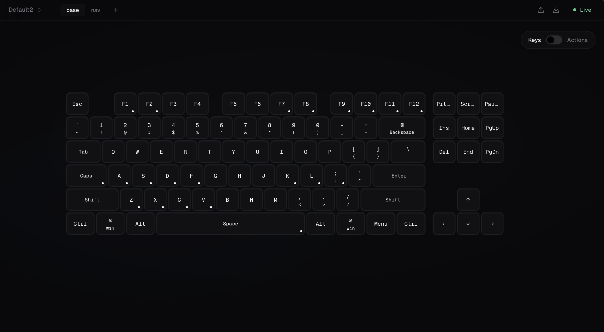

<div align="center">
  
  <h1>mantle</h1>
</div>
<br><br>

A visual keyboard configurator for [Kanata](https://github.com/jtroo/kanata) — the cross-platform software keyboard remapper.

Build complex keyboard layouts with an intuitive GUI instead of writing Lisp configuration files by hand.



## Features

- **Visual Keyboard Editor** — Click keys to configure them, see your layout at a glance
- **Tap-Hold Actions** — Easily set up dual-function keys (e.g., Caps Lock → Escape on tap, Control on hold)
- **Layer Management** — Create and switch between multiple keyboard layers
- **Key Autocomplete** — Searchable dropdown with all Kanata key codes organized by category
- **Live Reload** — Changes apply immediately when Kanata is running
- **Auto-Save** — Configuration persists automatically
- **macOS** — Currently supported platform

## Installation

### Download

Download the latest release from the Releases page.

## Usage

1. **Launch Mantle**
2. **Click "Stopped"** in the top-right to start Kanata (you'll be prompted for your password on macOS)
3. **Click any key** on the visual keyboard to select it
4. **Configure the key** in the right panel:
   - **Simple**: Remap to another key
   - **Tap-Hold**: Different action on tap vs. hold
   - **Layer**: Activate a different layer
5. **Click "Apply"** to save your changes

### Layers

Layers let you have multiple keyboard layouts you can switch between:

1. Click **+ Add Layer** in the header
2. Name your layer (e.g., "nav", "symbols")
3. Configure a key to activate the layer:
   - Select a key (e.g., Space)
   - Choose **Tap-Hold** action
   - Set **Tap Key** to `spc`
   - Set **Hold Key**, click the dropdown and choose your layer
4. Switch to your new layer tab and configure the keys

## Configuration Files

Mantle stores configuration in:

- **macOS**: `~/Library/Application Support/mantle/kanata/`

Files:

- `config.json` — Your keyboard configuration (JSON format)
- `kanata.kbd` — Generated Kanata config (Lisp format, auto-generated)

## Development

### Prerequisites

- Node.js 18+
- pnpm

### Setup

```bash
git clone https://github.com/YOUR_USERNAME/mantle.git
cd mantle
pnpm install
```

### Run in Development

```bash
pnpm start
```

### Build for Production

```bash
pnpm run tauri:build
```

Outputs are in `src-tauri/target/release/bundle/`.

### Project Structure

```
mantle/
├── src/
│   ├── renderer.tsx       # React entry point
│   ├── App.tsx            # Main React component
│   ├── components/
│   │   ├── keyboard/      # Visual keyboard components
│   │   ├── editor/        # Key configuration editor
│   │   └── status/        # Status indicator
│   ├── contexts/          # React contexts for state
│   ├── kanata/            # Kanata parsing helpers
├── src-tauri/             # Rust backend + Tauri config
└── vite.*.config.ts       # Vite configs
```

## Contributing

Contributions are welcome! Please open an issue first to discuss what you'd like to change.

## License

MIT License — see [LICENSE](LICENSE) for details.

## Acknowledgments

- [Kanata](https://github.com/jtroo/kanata) by jtroo — The amazing keyboard remapper this UI is built for
- [Karabiner-Elements](https://karabiner-elements.pqrs.org/) — For the macOS virtual HID driver
